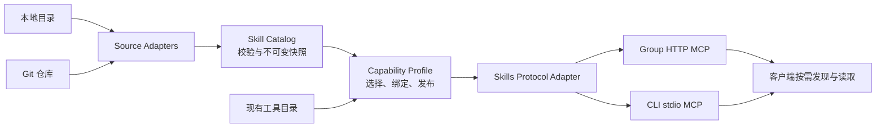

# Skills 获取、管理与统一 MCP 分发规划

- 日期：2026-10-11
- 状态：Draft，功能与技术方案；配置字段和管理接口为拟议设计
- 项目：MCP Knot（原 MCP Hub）
- 主要输出：现有 `/:group/mcp` 统一端点
- 研究依据：[Skills over MCP 官方资料核查](../../research/2026-10-11-skills-over-mcp.md)

## 1. 目标与使用场景

让 Hub 从本地、Git 等来源获取标准 Agent Skills，将技能整理成可检索、可锁定版本的目录，再按场景与现有 MCP 工具一起发布。客户端连接一个组端点，即可发现该场景需要的技能和工具，并按需读取技能正文、参考文件、模板和脚本文件。

完整链路是：**获取 → 校验与快照 → 技能目录 → 选择与组合 → 发布 → 按需读取**。

典型场景：

1. 团队接入内部 `team-playbooks` 仓库，仅选择 `review`、`release` 两个技能，分别提供给开发组和发布组。
2. 管理者从一个公共仓库浏览几十个技能，预览后只导入所需目录，不把整个仓库暴露给客户端。
3. 一个 `frontend-dev` 组组合代码审查、设计规范和部署技能，并提供其需要的 Git、文件和部署 MCP 工具。
4. 仓库发布新版本后，Hub 展示变更，生成待发布版本；已有端点继续读取已发布版本，发布后可回滚。
5. 一个纯知识/工作流端点只提供 Skills，不要求配置上游 MCP server。
6. 同一仓库的同一份技能被多个组引用，文件缓存复用，各组的访问权限和工具配置独立。

技能文件的获取和托管由 Hub 完成；模型选择、加载技能及需要的宿主交互由客户端完成。技能附带脚本可以作为文件分发，是否在客户端执行取决于客户端能力和授权。

## 2. 已核实的基础与协议约束

### 2.1 当前仓库

| 已有能力                        | 实现位置                                                        | 本次复用方式                                 |
| ------------------------------- | --------------------------------------------------------------- | -------------------------------------------- |
| 按组提供 MCP HTTP 端点          | `backend/src/api/mcp/group-router.ts`、`mcp-handler-factory.ts` | 同一端点注册 Skills 与资源读取               |
| 工具筛选和聚合                  | `backend/src/api/mcp/group-service.ts`                          | 保留工具行为，增加技能选择与绑定检查         |
| Hub 元数据资源                  | `group-service.ts:476` 起                                       | 在现有资源集合中增加技能文件                 |
| MCP v2 及旧协议兼容层           | `packages/protocol/`                                            | 明确 Skills 在各协议/客户端模式中的支持情况  |
| 配置 Schema 与派生类型          | `packages/share/src/config/`                                    | 增加来源、选择和发布配置，统一前后端类型     |
| 共享实例注册、启动及关闭流程    | `backend/src/services/service-registry.ts`                      | 注册技能运行时与同步任务，避免请求时重复创建 |
| 分组认证、OAuth、validation key | `backend/src/middleware/mcp-auth.ts`、`services/oauth/`         | 将技能权限接入相同认证链路                   |
| CLI、配置管理及 Web 管理界面    | `packages/cli/`、`frontend/`                                    | 管理命令与 HTTP/stdio 共享技能实现           |

当前尚无 Skills 协议接口、仓库技能同步及技能文件托管。落地时还要处理以下既有约束：

- `McpConfigSchema` 要求至少一个服务器；`GroupSchema.servers` 要求至少一个成员。需要支持纯 Skills 配置，在整体配置/发布校验时判断组合是否有效。
- 组的多条创建、更新、运行时映射路径逐项复制字段；新增 `skills`、`bundles` 字段必须在读、写、更新及前端往返中保留。
- MCP 入口当前固定要求 `mcp:tools`，不能直接假定已有 method 级权限。需要迁移规则，以便只读技能客户端访问。
- 对外工具名为 `serverId_toolName`；技能中预期的工具名可能不同，需显式绑定与检查。
- CLI 与 backend 的现有连接实现不同。共享技能模块应独立于上游工具连接实现，不在本次顺带重写工具连接层。

### 2.2 Skills over MCP

官方扩展为 `io.modelcontextprotocol/skills`，基于 MCP `2026-07-28`；服务需声明 Resources 与 Skills 扩展，并提供 `skills/list`、`skills/get`、`resources/read`。`resources/directory/read` 为可选能力。[官方扩展概述](https://modelcontextprotocol.io/extensions/skills/overview)、[稳定规范](https://github.com/modelcontextprotocol/ext-skills/blob/main/specification/stable/skills.mdx)

列表/查询条目包含 `SKILL.md` 的 URI、原样保留的完整 frontmatter，以及全部托管文件的 URI、SHA-256、字节数。分页不能拆散一个技能的文件清单；自定义 Skills 方法要返回完整的 `resultType`、`ttlMs`、`cacheScope`。现行规范没有 Skills 列表变化通知。[稳定规范](https://github.com/modelcontextprotocol/ext-skills/blob/main/specification/stable/skills.mdx)、[Inspector 测试说明](https://github.com/modelcontextprotocol/inspector/blob/main/docs/test-servers.md#skills-sep-2640)

客户端需支持扩展及按需加载、内容校验。普通资源读取不等于激活技能；支持本地 Skills 或普通 MCP 也不等于支持远端 Skills。[客户端要求与支持矩阵](https://modelcontextprotocol.io/extensions/client-matrix)、[加载要求](https://modelcontextprotocol.io/extensions/skills/overview#user-interaction-model)

本仓库安装的 SDK `2.0.0` 暴露 `McpServer.server`、连接前的 `registerCapabilities` 与三参数自定义 `setRequestHandler`。可以通过薄协议 Adapter 接入扩展，实施前用完整 HTTP 链路验证；不假定存在专用 `registerSkill` 接口。Skills 扩展的 envelope 不能照搬已有 tools handler 的自动补字段行为。

## 3. 产品中的对象

| 对象          | 含义                                   | 身份/版本                                               |
| ------------- | -------------------------------------- | ------------------------------------------------------- |
| Source        | 获取来源，例如本地目录或一个 Git 仓库  | 稳定 `sourceId`，认证信息独立引用                       |
| Candidate     | 来源中已发现、尚未导入的技能目录       | `sourceId + rootPath`，标明候选 revision                |
| Skill         | 标准技能，含 `SKILL.md` 与全部支持文件 | `skillId = sourceId + normalizedRootPath`，名称只作标签 |
| SkillRevision | 一份不可变技能快照                     | 内容摘要、来源 commit/本地快照 ID、文件清单             |
| Catalog       | Hub 可查询的技能目录                   | 索引技能、版本、来源、标签和兼容性                      |
| Bundle        | 可复用的技能集合及可选工具要求         | Hub 自定义对象，不是 MCP 标准 package                   |
| Profile       | 一个 Group 发布的工具与技能视图        | 复用 Group 配置，生成 `profileRevision`                 |
| Publication   | 已验证并发布的 Profile 快照            | 固定 SkillRevision、选择规则结果和工具绑定              |
| SyncJob       | 一次发现、拉取、校验或更新任务         | 有进度、结果、取消和失败原因                            |

用户继续使用“组”管理场景；Profile 是组在运行时的完整能力视图，不另设一套重复的组管理体系。

`SkillRevision`、`profileRevision` 与来源 commit 是不同概念：仓库某次提交可能只改变无关文件，不必让未变化技能产生新内容版本；组只改变工具绑定也会产生新的发布版本。

## 4. 功能规划

### 4.1 来源获取

| 来源/能力     | 具体行为                                                               | 优先级   |
| ------------- | ---------------------------------------------------------------------- | -------- |
| 本地目录      | 单技能根目录或技能集合目录；相对路径基于配置文件目录                   | 第一阶段 |
| 公共 Git 仓库 | GitHub、GitLab 及普通 HTTPS Git URL；可指定子目录、branch、tag、commit | 第一阶段 |
| 仓库发现      | 按配置路径/glob 发现 `SKILL.md`，展示名称、目录、描述及候选版本        | 第一阶段 |
| 选择性导入    | 从候选目录中勾选技能，拉取该技能完整文件树；同仓库下载去重             | 第一阶段 |
| 手动同步      | 指定来源/技能，预览结果并生成待发布快照                                | 第一阶段 |
| 私有 Git      | 凭据引用、HTTPS token 或 SSH 身份；复用连接，避免泄露凭据              | 第二阶段 |
| 更新检查      | 定时检查 branch/tag，按来源频率、重试、限流和并发限制运行              | 第二阶段 |
| 导入压缩包    | ZIP/TAR 上传或受控下载；保留 origin 与归档摘要                         | 第二阶段 |
| 来源发现目录  | 从维护的索引推荐来源，可搜索并查看内容后导入                           | 后续增强 |

统一获取行为：

- 添加来源后先发现候选目录；是否导入全部或部分目录由配置决定。
- 将可变 ref 解析为 commit，再基于该 commit 拉取文件；同一次同步不能混用不同提交。
- 如果远端支持，可用目录/对象级获取降低下载量；完整 clone 是可接受的兼容实现。
- 本地目录同样先生成快照，已发布端点不直接读取仍在编辑的工作目录。
- 下载、校验和索引放在后台 SyncJob。`skills/list` 和 `resources/read` 不触发 Git fetch。
- 支持超时、进度、取消、重试和最后一次成功版本；同步失败不会替换已发布内容。
- 第一阶段以手动发布为默认。自动同步与自动发布是两个独立设置，自动发布后续按来源/组策略配置。

### 4.2 技能目录与质量检查

目录展示名称、描述、来源路径、revision、更新时间、标签、文件数、总字节数、许可证信息、兼容性及发布引用。

导入校验包含：

1. 标准 `SKILL.md`、frontmatter 和目录名称；保留未知 frontmatter 字段。
2. 支持文件、二进制附件、MIME、相对路径及内容完整性。
3. 文件数、单文件和总大小限额；默认适配官方建议的 512 文件/16 MiB 范围。
4. 技能根目录内完整文件清单与摘要；展示校验错误所在文件。
5. 参考文件缺失、已声明工具要求不可满足、宿主依赖不明等诊断。
6. 来源许可证、原创/派生关系与下载来源记录；内容中的授权声明不自动改变 Hub 权限。

Agent Skills 的目录与格式依据[官方格式规范](https://agentskills.io/specification)。Hub 的标签、管理员备注、工具绑定和质量状态存在独立元数据中，不改写第三方 frontmatter 或正文。

目录支持名称/描述/来源/标签搜索、状态筛选、文件预览、版本对比、重复内容提示和来源跳转。静态扫描只提供提示，不能保证自然语言工作流的正确性，也不能把模型推断的工具依赖当作权限配置。

### 4.3 四层按需

| 层次       | 按需的对象                 | 规则                                                  |
| ---------- | -------------------------- | ----------------------------------------------------- |
| 获取       | 一个仓库中的哪些技能       | 导入选中的技能目录，支持 explicit include/exclude     |
| 发布       | 哪些技能和工具进入一个组   | 来源、skillId、路径、标签及 Bundle 规则解析为确定集合 |
| 客户端加载 | 元数据、正文与附件         | 先发现条目，按需读取文件，不要求客户端整包下载        |
| 可选检索   | 大目录中的哪些技能值得选择 | Hub 搜索提供候选；模型/用户决定加载，遵守客户端授权   |

**服务端准备清单和客户端按需读取是两件事。** Hub 为选中的技能取得完整文件、计算摘要并形成快照，客户端仍只读取当前任务需要的文件。不能为了懒下载返回不完整的静态 manifest。

选择规则建议：

- 缺省新增组不公开任何技能，避免新来源自动进入所有组。
- 使用完整 skillId；仅按名称选择时，同名候选必须明确消歧。
- 明确列出的技能不存在/版本不可用时，阻止发布，并说明原因。
- 通配符只在组允许的来源范围内解析；exclude 和访问拒绝优先。
- 通配符匹配新技能产生发布候选，不直接扩大已发布集合。
- 标签筛选结果在发布时固定；改标签不会立即改变生产端点。
- 手动选择、Bundle 与依赖展开后去重；同一 skillId 的不同版本冲突默认阻止发布。

嵌套目录需要特别处理：发布一个外层技能会包含其完整文件树，里面的嵌套 `SKILL.md` 也是支持文件。排除嵌套技能的独立条目不代表它的文件已从外层技能中移除。预览必须显示这类包含关系；如果子目录内容不允许公开，则阻止原样发布外层技能，或明确创建移除该内容的派生版本。独立激活嵌套技能仍按客户端规则处理。[嵌套技能规范](https://github.com/modelcontextprotocol/ext-skills/blob/main/specification/stable/skills.mdx#nested-skills)

### 4.4 整合输出

建议分三种产品能力，避免混淆它们的行为：

| 能力       | 输出                    | 行为                                                |
| ---------- | ----------------------- | --------------------------------------------------- |
| 集合组合   | Bundle 中的多个完整技能 | 保留技能独立身份、文件及版本，方便复用              |
| 场景组合   | 一个 Group MCP 端点     | 同时提供选中的工具、技能及技能资源，作为主输出      |
| 工作流组合 | 新的 Composite Skill    | 管理者编写/审阅一个入口工作流，记录所依赖技能及来源 |

第一阶段实现集合与场景组合。工作流组合放在后续：把多个正文直接拼接会破坏步骤约束、相对路径和版本身份，应发布一个有自己名称、清单和版本的新技能。

复合工作流可引用其他技能 URI，但这不代表自动激活被引用技能；客户端须遵守嵌套技能的加载规则。若复用源文件或改写正文，则记录派生关系并重新计算摘要。

工具整合需要单独定义契约：

- 技能要求优先由管理员配置或 Hub 伴随描述明确声明，原始文本扫描只作建议。
- 发布预览显示所需 MCP 工具、宿主工具、系统依赖及缺失项。
- Hub 现有工具名与技能预期不一致时，可显式创建组级工具 alias，并让 `tools/list` 与 `tools/call` 使用同一映射。
- alias 冲突需明确解决，原有工具名继续兼容；不自动扩大工具白名单。
- 默认要求工具显式选择。依赖检查可建议补入，实际选择形成新的发布候选。
- 区分 MCP 工具、宿主 Read/Bash 等工具与本地软件。远端 Skills 可读取不代表其脚本已能在宿主运行。
- 工具离线、schema 改变或权限撤销可使发布视图降级并报告状态；锁定技能版本不能锁定外部工具的运行行为。

### 4.5 版本、更新和发布

每次发布生成锁定清单，包含 sourceId、来源 ref 的解析结果、skillId、SkillRevision、文件树摘要、Bundle 展开结果和工具绑定。

更新流程：

`检查来源 → 生成候选快照 → 校验 → 展示差异 → 解析组依赖 → 预览 → 发布`

差异应包含新增/删除技能、正文与附件变化、frontmatter、文件摘要、工具要求及许可证信息变化。权限或策略有变化时，预览应突出展示其影响。

发布使用不可变快照加原子活动指针：

- 候选版本未完成之前，客户端继续读取最后一次成功发布。
- 发布失败保持活动指针和原快照；不能只更新列表、未准备好文件。
- 支持发布历史、回滚及引用版本保留。
- 一个 `skills/list` 的所有页面固定在同一 Profile revision，cursor 不能因中途更新重复或遗漏技能。
- 旧版本文件在保留期内可继续读取，使已加载技能引用保持一致；每次读取仍检查当前权限。
- 删除组授权或撤销来源访问立即生效，旧 URI、cursor 和缓存不得绕过。
- 新发布改变 URI/摘要后，客户端依自身加载路径重新验证；Hub 的发布动作不替代客户端授权。

默认采用带 revision 的不可变 URI，例如：

```text
skill://team-playbooks/rev-<content-hash>/skills/review/SKILL.md
skill://team-playbooks/rev-<content-hash>/skills/review/references/checklist.md
```

sourceId 与根目录路径区分同名技能；技能根目录最后一段仍与 frontmatter `name` 一致。URI 只映射到已发布快照，不透露服务器绝对路径。活动版本由列表/查询呈现，不依赖一个会在读取中途变化的无版本文件地址。

## 5. MCP 对外契约

### 5.1 统一端点

继续使用 `/:group/mcp`。一个组可以包含 Tools、Skills 或两者；技能支持文件通过 Resources 分发，Hub 原有元数据 Resources 保持可用。

```json
{
  "capabilities": {
    "resources": {},
    "extensions": {
      "io.modelcontextprotocol/skills": {}
    }
  }
}
```

以上是 Skills 能力片段；组有工具时也声明对应 Tools 能力。第一阶段不宣告 `directoryRead`，后续实现后再启用。

| 方法                        | 返回/行为                              | 权限与一致性要求                                 |
| --------------------------- | -------------------------------------- | ------------------------------------------------ |
| `server/discover`           | 对外能力和 instructions                | 如实声明已实现的扩展                             |
| `skills/list`               | 组内可见技能的完整条目及 opaque cursor | 每页完整条目，确定排序，绑定发布版本             |
| `skills/get`                | 按 `SKILL.md` URI 获取一个完整条目     | 同时检查组、当前主体、发布状态及版本             |
| `resources/list`            | 原有 Hub 资源与已公开资源/模板的发现   | 与技能条目权限一致，技能文件也可从 manifest 定位 |
| `resources/read`            | 一个文件的文本或二进制内容             | 限定快照 manifest 内的 URI，字节与摘要一致       |
| `resources/directory/read`  | 可选目录直接子项                       | 后续启用，仅列组内已授权文件树                   |
| `tools/list` / `tools/call` | 现有工具及可选 alias                   | 维持工具权限和调用行为                           |

标准 `skills/list` 不自造 `query`、`tags` 等请求字段。产品搜索放在管理 Interface 中；后续可提供独立 MCP 搜索工具，清楚区分标准协议和 Hub 自定义能力。

### 5.2 缓存、错误和能力协商

- Skills list/get 默认 `cacheScope: private`；仅明确公共发布视图可使用 public。
- 缓存键至少包含组/发布版本/主体访问范围，文件缓存按 revision 与摘要复用。
- list/get 正确返回 `resultType: complete`、`ttlMs`、`cacheScope`；自定义方法不依赖 SDK 自动补字段。
- cursor 绑定组、发布版本、访问范围和有效期；权限改变后重新校验。
- 未知或不可见的 skill/file 使用一致的不可见响应，未知 URI 依规范返回 `-32602`；认证层区分未认证和无 scope。
- 扩展使用以客户端/服务器的能力声明为依据；请求中的 clientCapabilities 是能力描述，不是可信的身份或权限。
- 当前没有标准 Skills 变化通知；使用 list/get freshness 与新 revision 处理更新。管理页面仍可用现有 SSE 展示同步状态。

### 5.3 客户端兼容

测试矩阵至少覆盖：

1. modern HTTP 客户端，声明 Skills 扩展，发现并读取文件。
2. modern stdio 客户端，使用同一目录与协议 Adapter。
3. 仅支持 MCP Tools 的客户端，继续使用原工具能力。
4. legacy 客户端，基础能力保持兼容；单独核验是否支持扩展，不能仅因 legacy shim 存在就承诺远端 Skills。
5. 支持远端技能、但不能物化/执行脚本的宿主，能够识别该技能的环境要求。

可选兼容模式通过普通工具提供技能目录/文档读取，让旧客户端手动使用文档。该模式不宣称原生技能加载、摘要审批或嵌套激活已实现。导出本地技能包是后续辅助输出，不作为主链路的依赖。

## 6. 管理体验

Web 页面建议增加三个入口，组页面扩展能力配置：

| 页面    | 主要操作                                                   |
| ------- | ---------------------------------------------------------- |
| Sources | 添加来源、路径与 ref；检测连接；查看候选；同步和认证引用   |
| Skills  | 搜索、预览正文/文件、查看来源版本与诊断、比较 revision     |
| Bundles | 选技能、复用集合、检查重复与依赖，查看被哪些组引用         |
| Groups  | 选择工具/技能/Bundle、检查兼容性、预览完整视图、发布与回滚 |

操作流程：添加来源 → 浏览候选 → 选择导入 → 编排组 → 检查差异 → 发布 → 复制 MCP 连接配置。

“已发现”“已导入”“待发布”“已发布”“有更新”“不可用”应明确区分；来源同步成功不表示组已更新。

CLI 提供对应操作，例如 `sources add/scan/sync`、`skills list/show`、`groups preview/publish/rollback`。命令名在实现阶段与当前 CLI 子命令模式统一；支持 JSON 输出供自动化使用。

第一阶段可使用配置文件和 CLI 管理，Web 页面分阶段补齐。普通客户端连接的组端点默认只提供发布后的业务能力；管理来源、凭据和发布通过管理端权限执行。

## 7. 配置草案

建议新增 `skills.json` 管理技能来源与 Bundle，并扩展现有 `group.json`。已有配置未启用 Skills 时继续工作。下面字段为拟议 Interface，尚未实现。

```json
{
  "enabled": true,
  "storageDir": "./data/skills",
  "sources": {
    "team-playbooks": {
      "type": "git",
      "url": "https://github.com/example/team-playbooks.git",
      "ref": "main",
      "discover": ["skills/**/SKILL.md"],
      "import": { "include": ["skills/review", "skills/release"] },
      "sync": { "mode": "manual" }
    },
    "local-guides": {
      "type": "local",
      "path": "./skills",
      "discover": ["*/SKILL.md"],
      "import": { "include": ["*"] },
      "sync": { "mode": "manual" }
    }
  },
  "bundles": {
    "development": {
      "name": "Development",
      "skills": ["team-playbooks:skills/review", "local-guides:design"]
    }
  }
}
```

相对路径均基于该配置文件所在目录，避免 backend/CLI 因 cwd 不同得到不同结果。`sourceId:rootPath` 是配置中 skillId 的可读表示；实际规范化和 URI 编码由核心模块完成。

```json
{
  "frontend-dev": {
    "id": "frontend-dev",
    "name": "Frontend development",
    "servers": ["github", "deploy"],
    "tools": ["get_pull_request", "get_diff"],
    "bundles": ["development"],
    "skills": {
      "include": ["team-playbooks:skills/release"],
      "exclude": [],
      "dependencyPolicy": "explicit"
    }
  },
  "team-guides": {
    "id": "team-guides",
    "name": "Team guides",
    "servers": [],
    "tools": [],
    "skills": {
      "include": ["local-guides:design"],
      "exclude": [],
      "dependencyPolicy": "explicit"
    }
  }
}
```

`tools` 继续沿用现有筛选语义。新增技能选择不改变已有工具的默认暴露方式。缺省 `skills` 与 `bundles` 表示不公开技能。

发布生成 `skills.lock.json` 或等价运行时发布记录，锁定实际解析的内容 revision；`ref: main` 只用于检查候选更新，不能成为读取时的可变版本。锁文件不包含 token、SSH 私钥或绝对本地路径。

第二阶段扩展 `authRef`、`sync.intervalSeconds`、按来源发布策略及工具 alias 描述；实际认证材料独立存储或引用部署环境。

## 8. 模块设计与代码落点

采用共享核心 Module 与入口 Adapter。源获取、快照、权限和清单的一致性集中在核心 Interface，协议 handler 不直接读工作目录或访问 Git。



### 8.1 Skill Catalog Module

Interface 提供发现候选、导入/同步、查询 revision。Implementation 负责 frontmatter、来源记录、文件校验、完整清单、摘要、内容去重与快照保留。

真实可变的 Seam 是来源获取：本地与 Git 使用不同 Source Adapter，但产出同一 staged file tree。按需要再加入归档 Adapter，不预先抽象未知市场/平台。

调用者不需要了解 Git clone 目录、重试方式或文件缓存路径。查询已导入快照无网络依赖；来源失败有结构化错误及 last-good revision。

### 8.2 Capability Profile Module

Interface 提供 `plan(config, catalogView, toolCatalog)`、发布和按授权打开发布视图。Implementation 负责 Bundle 展开、选择冲突、依赖检查、锁定记录、发布指针和回滚。

`plan` 返回可检查结果，不修改生产状态；发布使用期待的配置/发布版本防止并发覆盖。真实工具的可用性仍在调用时校验。

### 8.3 Skills Protocol Adapter

Interface 将发布视图注册到 `McpServer`。Implementation 处理标准方法、SDK envelope、分页、URI 路由、缓存提示及错误映射。

所有 list/get/read 路径跨同一个授权 Seam。调用者注入经过认证的 AccessContext；不能从客户端 `_meta` 接受身份，也不能把某个用户权限捕获进组级共享缓存。

### 8.4 建议代码位置

| 位置                                                    | 工作                                                   |
| ------------------------------------------------------- | ------------------------------------------------------ |
| `packages/share/src/config/schemas/skills.schema.ts`    | 新配置 Schema、派生类型、交叉引用校验                  |
| `packages/share/src/config/schemas/group.schema.ts`     | 技能/Bundle 选择，纯技能组兼容                         |
| `packages/core/src/skills/`                             | Catalog、Profile、Source Adapters、快照 Implementation |
| `packages/core/src/skills/protocol/`                    | 共享 MCP Skills Adapter 与协议 schemas                 |
| `backend/src/services/`                                 | 注册共享技能运行时和后台 SyncJob 调度                  |
| `backend/src/utils/config.ts`、配置管理路径             | 读取/保存 skills 配置，保留新字段                      |
| `backend/src/api/skills/`                               | 管理 Interface：来源、技能、任务、版本                 |
| `backend/src/api/mcp/group-service.ts`                  | 注入组发布视图，注册技能文件                           |
| `backend/src/api/groups/`                               | 组预览/发布、选择规则及字段往返                        |
| `backend/src/middleware/mcp-auth.ts`、`services/oauth/` | 按操作验证 scope 与组访问                              |
| `packages/cli/`                                         | 来源管理命令、配置路径解析、stdio Adapter 接入         |
| `frontend/src/views/`                                   | 来源/技能/Bundle 页面及组配置                          |

先复用现有错误、日志和配置方式。初版快照用本地文件存储加原子记录；增加数据库/对象存储或多节点部署后，才引入相应持久化 Adapter。

## 9. 管理 Interface 草案

| 操作        | 拟议 HTTP Interface                                       | 结果                                        |
| ----------- | --------------------------------------------------------- | ------------------------------------------- |
| 管理来源    | `GET/POST /api/skills/sources`、`PATCH/DELETE /:sourceId` | 配置与连接状态，敏感字段只返回引用/脱敏结果 |
| 发现与同步  | `POST /api/skills/sources/:sourceId/scan`、`/sync`        | jobId，支持 selected skill roots            |
| 任务状态    | `GET /api/skills/jobs/:jobId`、`POST /:jobId/cancel`      | 当前阶段、进度、错误及候选 revision         |
| 技能检索    | `GET /api/skills`                                         | 分页、query、来源、标签、兼容性筛选         |
| 技能详情    | `GET /api/skills/:skillId`、`/revisions`、`/files`        | 已授权元数据、版本与受控文件预览            |
| Bundle 管理 | `GET/POST /api/skills/bundles`、`PATCH/DELETE /:bundleId` | 可复用选择集合与引用关系                    |
| 发布预览    | `POST /api/groups/:groupId/preview`                       | 确定选择、缺失依赖、文件/工具变化           |
| 发布与回滚  | `POST /api/groups/:groupId/publish`、`/rollback`          | publicationId/profileRevision，活动版本     |

上述都是管理 Interface，不是 MCP 新标准方法。路径参数的 opaque skillId 编码需统一；不能直接把仓库路径拼接成服务器文件路径。

后台任务同源去重，发布有并发版本检查；一个失败任务不阻塞无关来源。可取消的任务在发布前清理 staging，不删除已有快照。

## 10. 访问控制与文件处理

这是分发外部技能和脚本文件所需的运行契约：

- Source 的读取凭据与客户端身份分开。客户端能够读发布技能，不代表能够读取来源 token 或整个私有仓库。
- 目录、列表、查询、文件读取、搜索、缓存、管理预览采用一致的组与主体授权。
- 新增 method 级 scope，例如 `mcp:skills:read` 与 `mcp:tools`；资源读取按资源类型判断。具体 scope 名称由实施时统一确定。
- 已有 `mcp:tools` token 的技能访问迁移必须显式配置；不能无条件赋予新增私有内容的权限。
- 拉取内容不执行仓库脚本、安装命令或发布钩子；Git submodule/LFS 等行为默认关闭，必要时由来源策略启用。
- URI/path canonicalization、符号链接/硬链接、归档解压、重定向和网络目标限制由获取/读取模块统一处理。
- 只公开 snapshot manifest 内的文件。无论以名称、URI 或目录访问，都不能读取配置、凭据或技能目录外的内容。
- 私有内容默认使用 private 缓存；摘要表示内容一致，不代表内容可信。
- `allowed-tools` 等原始字段保留并展示，不能成为 Hub 的授权配置。
- 同名技能不会互相覆盖；Bundle 不静默降级版本，也不隐式增权。

支持“发现/编辑来源”“编排组”“发布”“只读使用”等权限，初版可先复用现有管理员权限；更细角色在多团队阶段补齐。

## 11. 存储、运行与运维

推荐布局：

```text
data/skills/
  staging/<job-id>/
  blobs/<sha256>/
  revisions/<revision-id>/manifest.json
  catalogs/<catalog-revision>.json
  publications/<group-id>/<profile-revision>.json
  active/<group-id>.json
```

blob 复用，revision 与 publication 不可变，活动指针原子替换。锁/任务去重保护同源同步和同组发布；进程异常后清理未完成 staging，可继续使用完整发布记录。

运维能力：

- 同步耗时、失败次数、排队长度、读取延迟、字节流量、缓存命中率与磁盘占用。
- 日志记录 sourceId、skillId、revision、groupId、jobId；不记录认证材料或整份私有正文。
- 来源失联/凭据过期/候选非法时，区分“有旧发布可用”和“从未成功导入”。
- 显示工具依赖降级与最近更新检查结果。
- GC 根据活动发布、锁定版本、回滚保留和在用旧 revision 引用删除文件；先完成引用计算，再删除未引用 blob。
- 备份来源配置、必要凭据引用、发布记录和引用文件；恢复后离线读取已发布快照。
- 多实例版本需要共享任务锁、存储和原子发布记录；本地初版明确为单实例部署契约。

## 12. 分阶段落地

| 阶段        | 交付范围                                                                                                                       | 验收目标                                                             |
| ----------- | ------------------------------------------------------------------------------------------------------------------------------ | -------------------------------------------------------------------- |
| 0：协议验证 | 本地标准技能 fixture、完整 manifest、Skills handlers、HTTP 与 stdio                                                            | 当前 SDK/协议链路能发现、查询并按摘要读取文件；工具与 Hub 资源共存   |
| 1：可用闭环 | 本地 + 公共 Git，候选发现/选择导入，快照/锁版本，组选择，统一端点，基础 scope 与旧 token 迁移配置，CLI/配置管理，手动发布/回滚 | 从仓库选两个技能，发布到不同组；纯 Skills 组可用；离线服务已发布快照 |
| 2：日常管理 | 私有来源、定时检查、diff、Bundle、工具依赖/alias，Web 管理、细分访问角色和可选目录读取                                         | 可审阅更新并发布；新文件不提前暴露；跨组与越权 URI 测试通过          |
| 3：高级组合 | Composite Skill、按权限检索、兼容工具模式、可选技能包导出、多团队治理                                                          | 新组合有独立版本/来源记录；客户端能力差异可见；授权与内容验证可测    |

阶段 1 必须同时包含“获取、选择、分发”的闭环，不能只完成本地 `SKILL.md` 展示。阶段 0 是确认 SDK 与宿主行为的技术验证，完成后才进入大范围产品实现。

初版优先使用手工编排与确定性规则。自动推荐/LLM 生成组合可以在后续加入，并形成可预览的新技能版本；不作为发布成功的必要依赖。

## 13. 验收与测试面

通过 Module 的 Interface 验证可观察行为，保留 HTTP/stdio 端到端用例覆盖 SDK 接入差异。

1. **仓库导入**：给定 ref 解析到 commit，只导入选中技能；非法候选有具体诊断。
2. **格式/文件**：任意 frontmatter 字段保留，文本与二进制字节不被重编码，hash 与 size 正确。
3. **分组**：A 组 list/get/read 看不到 B 组技能，手工构造 URI 或 cursor 也不能绕过。
4. **同名/重复/嵌套**：不同来源同名技能并存；同版本内容可去重；冲突版本阻止发布；外层文件树不会绕过对子目录内容的发布限制。
5. **工具组合**：显式绑定、alias 冲突和缺失依赖按配置处理；原工具调用继续工作。
6. **更新一致性**：同步/发布中断或仓库更新时，列表、分页和读取仍指向完整可用快照。
7. **旧版本/撤销**：保留期内旧内容一致；权限撤销立即阻断旧 URI，回滚恢复完整发布。
8. **缓存**：组/用户访问范围不会串缓存；技能列表更新靠规范 freshness 与 revision 生效。
9. **协议**：扩展声明、完整 envelope、cursor、直接 get、错误码及文件清单均合规。
10. **兼容性**：HTTP、stdio、Tools-only、legacy 模式与脚本宿主限制分别验证。
11. **纯技能端点**：服务器列表为空的配置、组管理、启动、认证和技能读取全链路通过。
12. **运维**：同源同步去重、取消/重试、进程恢复、GC 与离线读取，不删除仍被引用版本。

## 14. 关键决定与待验证事项

已选方向：统一 MCP 端点优先；复用 Group；优先本地/公共 Git；不可变快照；发布时固定选择；完整 manifest；控制面与读取解耦；默认不把新来源技能公开给全部组。

实施前必须验证：

- 当前安装 SDK 的自定义 Skills 方法在真实 `createMcpHandler`、stdio 和 legacy 路径中的完整响应与能力协商。
- 目标客户端是否实现 Skills 扩展、校验与脚本物化能力，基于实际版本记录结果。
- 经认证的主体如何进入共享 MCP handler 的每请求上下文，避免组级缓存捕获用户状态。
- scope 迁移、当前 Group 字段映射和纯技能启动链路需要哪些兼容改动。

默认实施建议：阶段 0 后直接完成阶段 1 的仓库获取与统一端点闭环，再推进日常管理。技能包导出、脚本沙箱执行、自动生成工作流等扩展功能保持独立，不增加首版协议分发的必要复杂度。

## 15. 参考

- [Cloudflare 2026-10-10 更新](https://developers.cloudflare.com/changelog/post/2026-10-10-cloudflare-mcp-skills/)
- [Skills over MCP 概述](https://modelcontextprotocol.io/extensions/skills/overview)
- [稳定扩展规范](https://github.com/modelcontextprotocol/ext-skills/blob/main/specification/stable/skills.mdx)
- [Agent Skills 格式](https://agentskills.io/specification)
- [扩展客户端支持矩阵](https://modelcontextprotocol.io/extensions/client-matrix)
- [Inspector Skills 测试接入](https://github.com/modelcontextprotocol/inspector/blob/main/docs/test-servers.md#skills-sep-2640)
- [SDK Skills 工作项](https://github.com/modelcontextprotocol/typescript-sdk/issues/2798)
